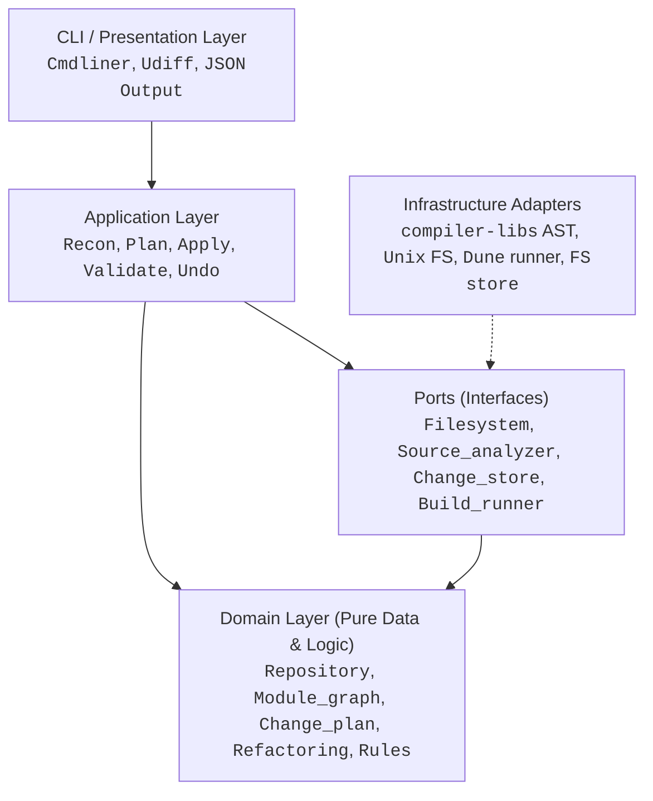

# kiss33

[]()
[]()
[]()

> **Compiler-aware refactoring engine and architecture modeler for large OCaml repositories.**

`kiss33` is not a collection of ad-hoc filesystem scripts or blind regex find-and-replace tools. It analyzes OCaml repositories, understands Dune build scopes and module namespaces, and performs safe, repeatable refactorings through explicit, validatable **Change Plans**.

Every mutating operation follows a strict transactional workflow:
```
kiss33 plan move  ──>  kiss33 preview  ──>  kiss33 apply  ──>  kiss33 validate
                                                                       │
                                                      (if needed) ◄────┘
                                                      kiss33 undo
```

---

## Key Features

- **Semantic Module & File Moves**:
  - Automatically updates module references across files (handling both intra-scope and cross-scope references, including wrapped library prefixes like `Sample_lib.Module`).
  - Auto-couples `.ml` and `.mli` files so interfaces never get left behind.
  - Automatically rewrites Dune `(modules ...)` explicit and difference lists.
- **Dependency Graph & Cycle Detection**:
  - Computes file- and module-level dependency graphs deterministically.
  - Detects dependency cycles using Tarjan's SCC algorithm with canonical sorting.
- **Safety Preconditions & Invariants**:
  - Validates pre-conditions (content hash digests, destination paths being free) before executing.
  - Rejects stale changes and conflicting edits cleanly without corrupting the working tree.
- **Full Atomic Undo & Backups**:
  - Preserves exact byte-level snapshots under `.kiss33/backup/` for every touched file.
  - Allows one-command safe rollback via `kiss33 undo`.
- **Architectural Rules & Reporting**:
  - Flags unassigned source files (files not governed by any Dune stanza).
  - Detects `(modules ...)` drift against directory contents.
  - Warns on missing interface files (`.mli`) and unresolved external symbols.
- **CI-Ready & Hexagonal Design**:
  - Stable exit codes and optional `--json` output across all commands.
  - Strict Domain-Driven Design (DDD) + Ports and Adapters architecture.

---

## Architecture

`kiss33` follows Domain-Driven Design (DDD) and Hexagonal Architecture (Ports and Adapters). Dependencies strictly point inward:



- **Domain (`lib/domain/`)**: Pure OCaml types and algorithms (no I/O, no filesystem). Contains repository models, change plans, AST location types, Tarjan SCC, and refactoring planning.
- **Ports (`lib/ports/`)**: Module signatures defining dependencies required by the application.
- **Infrastructure (`lib/infrastructure/`)**: Concrete adapters using OCaml's `compiler-libs` (AST traversal), POSIX filesystem operations, Dune runner, and `.kiss33/` storage.
- **Application (`lib/application/`)**: Use cases orchestrating domain entities and ports.
- **CLI (`lib/cli/`, `bin/`)**: Command routing, arguments, diff rendering, formatting, and stable exit code handling.

---

## Installation & Build

### Prerequisites
- OCaml >= 5.2 (tested up through OCaml 5.4.1)
- Dune >= 3.13
- `cmdliner`, `yojson`, `compiler-libs`, `alcotest`

### Build from source
```bash
git clone https://github.com/your-org/kiss33.git
cd kiss33
eval $(opam env)
dune build @all
```

Run tests (67 unit, property-based & e2e integration tests):
```bash
dune runtest
```

Install locally:
```bash
dune install
```

---

## CLI Reference

```
kiss33 [COMMAND] [OPTIONS]
```

### Common Flags
- `--root <DIR>`: Path to the repository root (defaults to current working directory).
- `--json`: Format all command output as structured JSON.
- `--help`: Display contextual help and options.

### Inspection & Analysis
| Command | Description |
|---|---|
| `kiss33 scan` | Inventory files, hashes, and Dune build scopes. |
| `kiss33 tree` | Display directories and their OCaml compilation units. |
| `kiss33 inspect <FILE>` | Deep inspection of an OCaml file: defined modules, references, and Dune scope forms. |
| `kiss33 deps [--dot]` | Show the module dependency graph (or output Graphviz DOT). |
| `kiss33 cycles` | Detect module dependency cycles with Tarjan SCC. |
| `kiss33 smells [<PATH>]` | Run Clean Code smell detection engine across 12 categories with actionable refactoring suggestions. |
| `kiss33 report` | Run architectural linter (cycles, unassigned sources, module drift, missing interfaces). |

### Refactoring Workflow
| Command | Description |
|---|---|
| `kiss33 plan move <SRC> <DST>` | Generate a change plan to move/rename a file or directory with semantic rewrites. |
| `kiss33 plan rename-fn <FILE> <OLD> <NEW>` | Plan renaming a top-level function across definition, `.mli` interface, and all call sites repo-wide. |
| `kiss33 plan move-fn <SRC> <DST> <FN>` | Plan moving a top-level function to another module with `.mli` sync and call site updates. |
| `kiss33 plan rename-arg <FILE> <FN> <OLD> <NEW>` | Plan renaming a function argument (positional, labeled `~x`, or optional `?x`) across definition, body usages, `.mli`, and call sites. |
| `kiss33 plan remove-arg <FILE> <FN> <ARG>` | Plan removing an unused argument from definition, `.mli` signature, and call sites (rejects if used in body). |
| `kiss33 plan label-arg <FILE> <FN> <ARG> <LABEL>` | Plan converting a positional parameter to labeled `~label` with `.mli` and call site rewrites. |
| `kiss33 plan unlabel-arg <FILE> <FN> <LABEL>` | Plan converting a labeled `~label` parameter back to positional; rejects optional `?x` and out-of-order call sites. |
| `kiss33 plan extract-constant <FILE> <LIT> <NAME>` | Plan extracting repeated magic literal strings/numbers into a top-level constant. |
| `kiss33 plan rename-type <FILE> <OLD> <NEW>` | Plan renaming a type across declarations, type annotations, and `.mli` interfaces repo-wide. |
| `kiss33 plan remove-unused-opens <FILE>` | Plan dropping `open` directives whose module is never used unqualified in the file. |
| `kiss33 plan qualify-open <FILE> <MODULE>` | Plan replacing top-level `open Module` with qualified `Module.ident` references throughout the file. |
| `kiss33 plan wrap-primitive <FILE> <FN> <ARG> <NEW_TYPE>` | Plan wrapping primitive types into a strongly-typed domain record/variant, eliminating Primitive Obsession. |
| `kiss33 plan replace-exception-with-result <FILE> <FN>` | Plan modernizing legacy `failwith` / `invalid_arg` into explicit `(res, string) result` return types with call site updates. |
| `kiss33 plan introduce-param-object <FILE> <FN> --args <A,B,...> --record <NAME>` | Plan grouping contiguous parameters into a record type with `.mli` sync and call site rewriting (incl. punning). |
| `kiss33 plan extract-fn <FILE> <RANGE> <NEW_FN_NAME>` | Plan extracting an expression or statement range into a top-level function, automatically computing free variables as parameters and substituting call sites. |
| `kiss33 plan decompose-match <FILE> <FN>` | Plan extracting branches of a pattern match into dedicated pure handler functions (`handle_<fn>_<pat>`), reducing cyclomatic complexity. |
| `kiss33 plan inline-fn <FILE> <FN>` | Plan inlining a function body across all call sites repo-wide, substituting arguments and removing the definition and `.mli` spec. |
| `kiss33 plan rename-field <FILE> <TYPE> <OLD_FIELD> <NEW_FIELD>` | Plan renaming a record field in declarations, literals (including punned), field projections, and patterns. |
| `kiss33 plan rename-constructor <FILE> <TYPE> <OLD_CTOR> <NEW_CTOR>` | Plan renaming a variant constructor in declarations, pattern matches, and expressions repo-wide. |
| `kiss33 plan rename-module <SRC_MODULE> <NEW_MODULE> [--file=FILE]` | Plan renaming a file-level module (with file moves, dune updates, and reference rewrites) or an inner submodule. |
| `kiss33 plan reorder-args <FILE> <FN> <NEW_ORDER>` | Plan reordering parameters of a function in definition, companion `.mli`, and call sites repo-wide. |
| `kiss33 plan remove-unused-fn <FILE> <FN>` | Plan removing an unused private function with no callers in the repository. |
| `kiss33 plan extract-mli <FILE>` | Plan generating a clean companion `.mli` interface from an existing `.ml` implementation file. |
| `kiss33 plan sync-mli <FILE>` | Plan synchronizing companion `.mli` with `.ml` implementation, adding missing signatures and removing obsolete ones. |
| `kiss33 plan split-module <FILE> --submodule <NAME> --functions <FNS>` | Plan splitting a large module into cohesive submodules, moving selected functions and updating call sites and Dune rules. |
| `kiss33 preview [PLAN]` | Show byte-precise unified diffs and operations of a plan (defaults to latest). |
| `kiss33 diff [--plan=PLAN]` | Show unified diffs for a plan or applied changes. |
| `kiss33 apply [PLAN]` | Execute the plan transactionally with automatic backups. |
| `kiss33 validate` | Run AST parse checks and Dune build to ensure repository health. |
| `kiss33 undo [PLAN]` | Roll back an applied plan from `.kiss33/backup/`. |
| `kiss33 status` | List recorded change plans and their current states (`pending`, `applied`, `undone`). |

---

## Example Walkthrough

### 1. Plan a Move
Move `lib/util.ml` to `lib/common.ml`. `kiss33` will automatically detect that `lib/util.mli` exists and couple it into the move, as well as finding all references in calling modules and Dune files:

```bash
$ kiss33 plan move lib/util.ml lib/common.ml
created .kiss33/plans/plan-0001.json
  move lib/util.ml -> lib/common.ml (1 file, 3 edited)
  operations:
    mkdir lib
    move  lib/util.ml -> lib/common.ml
    move  lib/util.mli -> lib/common.mli
    edit  bin/main.ml (1 edits)
    edit  lib/dune (1 edits)
    edit  lib/helper.ml (1 edits)
next: kiss33 preview .kiss33/plans/plan-0001.json
```

### 2. Preview the Diffs
```bash
$ kiss33 preview
plan plan-0001: move lib/util.ml -> lib/common.ml (1 file, 3 edited)
command: kiss33 plan move lib/util.ml lib/common.ml

+++ b/bin/main.ml
--- a/bin/main.ml
@@ -1,4 +1 @@
 let () =
-  let x = Sample_lib.Util.version () in
+  let x = Sample_lib.Common.version () in
   let y = Sample_lib.Helper.describe 42 in
   print_endline (x ^ y)

+++ b/lib/dune
--- a/lib/dune
@@ -1,3 +1 @@
 (library
  (name sample_lib)
- (modules util helper))
+ (modules helper common))

+++ b/lib/helper.ml
--- a/lib/helper.ml
@@ -1,3 +1 @@
-open Util
+open Common
```

### 3. Apply the Plan
```bash
$ kiss33 apply
applied plan-0001
  2 moved, 3 edited, 0 written, 1 dirs created
next: kiss33 validate
```

### 4. Validate
```bash
$ kiss33 validate
[ ok ] parse-check (5 files)
[ ok ] build
```

### 5. Safe Rollback
If you ever want to revert:
```bash
$ kiss33 undo
restored lib/helper.ml
restored bin/main.ml
restored lib/dune
moved back lib/common.mli -> lib/util.mli
moved back lib/common.ml -> lib/util.ml
```

### 6. Function-Level Refactoring

Rename a top-level function across its definition, `.mli` val spec, and all call sites in the repository:
```bash
# Plan rename
$ kiss33 plan rename-fn lib/util.ml hello greet_msg
created .kiss33/plans/plan-0002.json
  rename fn hello -> greet_msg in lib/util.ml (3 files edited)
  operations:
    edit  bin/main.ml (1 edits)
    edit  lib/util.ml (2 edits)
    edit  lib/util.mli (1 edits)

# Preview and apply
$ kiss33 preview
$ kiss33 apply
$ kiss33 validate
```

Move a function from one module to another:
```bash
# Plan function move
$ kiss33 plan move-fn lib/util.ml lib/extra.ml greet_msg
created .kiss33/plans/plan-0003.json
  move fn greet_msg from lib/util.ml to lib/extra.ml (3 files edited)
  operations:
    edit  bin/main.ml (1 edits)
    edit  lib/extra.ml (1 edits)
    edit  lib/util.ml (1 edits)

$ kiss33 apply
$ kiss33 validate
```

### 7. Function Argument Refactoring

#### Rename a Function Argument
Rename a positional or labeled/optional argument. For positional arguments, definition and body usages are updated without breaking callers. For labeled arguments (`~x` or `?x`), the parameter definition, the arrow signature in `.mli`, and call sites across the codebase (`~old:v` -> `~new:v`, punned `~old` -> `~new:old`) are updated:

```bash
# Rename labeled argument ~fmt to ~format
$ kiss33 plan rename-arg lib/util.ml greet fmt format
created .kiss33/plans/plan-0004.json
  rename arg 'fmt' -> 'format' in greet (lib/util.ml) (3 files edited)
  operations:
    edit  bin/main.ml (1 edits)
    edit  lib/util.ml (2 edits)
    edit  lib/util.mli (1 edits)

$ kiss33 preview
$ kiss33 apply
$ kiss33 validate
```

#### Remove an Unused Argument
Remove an obsolete argument from function definitions, interface signatures (`.mli`), and labeled call sites. Kiss33 enforces a safety invariant: if the argument is referenced in the function body, the plan is rejected with `Arg_in_use`:

```bash
# Remove unused argument `dummy`
$ kiss33 plan remove-arg lib/util.ml greet dummy
created .kiss33/plans/plan-0005.json
  remove arg 'dummy' from greet (lib/util.ml) (2 files edited)
  operations:
    edit  lib/util.ml (1 edits)
    edit  lib/util.mli (1 edits)

$ kiss33 apply
$ kiss33 validate
```

#### Turn Positional Parameter to Labeled Parameter
Convert a positional parameter into a labeled parameter (`~label`), resolving Primitive Obsession at call sites:

```bash
# Convert positional parameter `prefix` to labeled `~prefix`
$ kiss33 plan label-arg lib/util.ml greet prefix prefix
created .kiss33/plans/plan-0006.json
  label param prefix as ~prefix in lib/util.ml:greet (3 files edited)
  operations:
    edit  bin/main.ml (1 edits)
    edit  lib/util.ml (1 edits)
    edit  lib/util.mli (1 edits)

$ kiss33 apply
$ kiss33 validate
```

### 8. Clean Code: Extract Magic Literals into Named Constants

Extract repeated string, int, or float literals into a top-level constant value:

```bash
# Extract repeated string literal into top-level constant
$ kiss33 plan extract-constant lib/util.ml "Hello, world!" default_greeting
created .kiss33/plans/plan-0007.json
  extract constant default_greeting = "Hello, world!" in lib/util.ml (2 occurrences replaced)
  operations:
    edit  lib/util.ml (3 edits)

$ kiss33 preview
$ kiss33 apply
$ kiss33 validate
```

### 9. Rename a Domain Type

Rename a type across its declaration, every type annotation, and the `.mli` interface:

```bash
$ kiss33 plan rename-type lib/util.ml token lexeme
created .kiss33/plans/plan-0008.json
  rename type token -> lexeme in lib/util.ml (3 files edited)
  operations:
    edit  bin/main.ml (1 edits)
    edit  lib/util.ml (2 edits)
    edit  lib/util.mli (2 edits)
  warning: constructors and fields of token are not renamed; only the type name is rewritten

$ kiss33 preview
$ kiss33 apply
```

### 10. Hygiene: Drop Unused Opens

Remove `open` directives that bring nothing into scope. Exports of the opened module are
resolved from its `.mli` (or `.ml`); opens whose exports cannot be determined — external
libraries, re-exports through `include` — are kept with a warning:

```bash
$ kiss33 plan remove-unused-opens lib/util.ml
created .kiss33/plans/plan-0009.json
  remove 1 unused open in lib/util.ml
  operations:
    edit  lib/util.ml (1 edits)

$ kiss33 preview   # verifies only the unused open disappears
$ kiss33 apply
$ kiss33 validate
```

### 11. Introduce Parameter Object

Group a contiguous run of parameters into a unified record type. Generates the record declaration,
rewrites the function definition with a punned record pattern, reshapes any companion `.mli` val spec,
and rewrites call sites repo-wide (with punning when argument variables match field names):

```bash
$ kiss33 plan introduce-param-object lib/util.ml area --args w,h --record dims
created .kiss33/plans/plan-0010.json
  group w, h of lib/util.ml:area into record dims (3 files edited)
  operations:
    edit  bin/main.ml (1 edits)
    edit  lib/util.ml (2 edits)
    edit  lib/util.mli (2 edits)

$ kiss33 preview
$ kiss33 apply
$ kiss33 validate
```

### 12. Extract Function

Extract an arbitrary expression or line range into a standalone top-level helper function. Free variables
are automatically computed and bound as parameters, and the extraction site is replaced with the function call:

```bash
$ kiss33 plan extract-fn lib/compute.ml 12-16 format_report
created .kiss33/plans/plan-0011.json
  extract range 12-16 in lib/compute.ml into function format_report
  operations:
    edit  lib/compute.ml (2 edits)

$ kiss33 preview
$ kiss33 apply
$ kiss33 validate
```

### 13. Decompose Match Expressions

Break down complex `match` expressions in dispatchers and large handlers into dedicated, testable pure helper
functions (`handle_<fn>_<case>`), dramatically reducing cyclomatic complexity:

```bash
$ kiss33 plan decompose-match lib/router.ml dispatch
created .kiss33/plans/plan-0012.json
  decompose match in dispatch (lib/router.ml) into 4 handlers
  operations:
    edit  lib/router.ml (5 edits)

$ kiss33 preview
$ kiss33 apply
$ kiss33 validate
```

### 14. Inline Function

Eliminate unnecessary layers of indirection by inlining a function's body into all its call sites repo-wide,
substituting arguments into parameters with operator precedence safety, and cleanly removing the definition
and its companion `.mli` specification:

```bash
$ kiss33 plan inline-fn lib/math.ml sq
created .kiss33/plans/plan-0013.json
  inline function sq in lib/math.ml (4 call site(s) updated)
  operations:
    edit  bin/main.ml (2 edits)
    edit  lib/compute.ml (2 edits)
    edit  lib/math.ml (1 edits)
    edit  lib/math.mli (1 edits)

$ kiss33 preview
$ kiss33 apply
$ kiss33 validate
```

### 15. Rename Record Field

Safely rename a record field in its declaration, pattern-matching destructuring, field projections (`r.field`),
record updates (`{ r with field = v }`), and punned expressions/patterns (`{ field }` $\to$ `{ new_field = field }`):

```bash
$ kiss33 plan rename-field lib/user.ml user_profile email user_email
created .kiss33/plans/plan-0014.json
  rename field user_profile.email -> user_email in lib/user.ml (3 files edited)
  operations:
    edit  lib/user.ml (4 edits)
    edit  lib/user.mli (1 edits)
    edit  bin/main.ml (2 edits)

$ kiss33 preview
$ kiss33 apply
$ kiss33 validate
```

### 16. Rename Variant Constructor

Rename a variant constructor across its declaration, mirror `.mli` specification, expressions, and pattern-matching:

```bash
$ kiss33 plan rename-constructor lib/token.ml token Word Lexeme
created .kiss33/plans/plan-0015.json
  rename constructor token.Word -> Lexeme in lib/token.ml (3 files edited)
  operations:
    edit  lib/token.ml (3 edits)
    edit  lib/token.mli (1 edits)
    edit  bin/parser.ml (2 edits)

$ kiss33 preview
$ kiss33 apply
$ kiss33 validate
```

### 17. Rename Module (File-level or Submodule)

Rename a file-backed module across the repository (moving `.ml` and `.mli`, updating `(modules ...)` in `dune`,
and rewriting all `open M` and qualified `M.foo` references) or rename an inner `module Sub = ...` definition:

```bash
# Rename top-level module (or file path)
$ kiss33 plan rename-module Util Common
created .kiss33/plans/plan-0016.json
  rename module Util -> Common (2 files moved, 3 files edited)
  operations:
    move  lib/util.ml -> lib/common.ml
    move  lib/util.mli -> lib/common.mli
    edit  lib/dune (1 edits)
    edit  bin/main.ml (2 edits)

# Or rename an inner submodule within a specific file
$ kiss33 plan rename-module --file lib/math.ml Algebra LinearAlgebra
```

### 18. Reorder Function Arguments

Reorder function parameters to place the pipeline target last (`|>`) or improve calling ergonomics:

```bash
$ kiss33 plan reorder-args lib/util.ml subtract y,x
created .kiss33/plans/plan-0017.json
  reorder arguments of subtract in lib/util.ml to [y, x] (3 files edited)
  operations:
    edit  lib/util.ml (2 edits)
    edit  lib/util.mli (1 edits)
    edit  bin/main.ml (1 edits)

$ kiss33 preview
# lib/util.ml:
# - let subtract x y = x - y
# + let subtract y x = x - y
# bin/main.ml:
# - Sample_lib.Util.subtract 10 3
# + Sample_lib.Util.subtract 3 10

$ kiss33 apply
```

### 19. Remove Unused Private Function

Prune dead functions that are not exported in `.mli` and have no callers across the repository:

```bash
$ kiss33 plan remove-unused-fn lib/util.ml dead_helper
created .kiss33/plans/plan-0018.json
  remove unused function dead_helper from lib/util.ml (1 file edited)
  operations:
    edit  lib/util.ml (1 edits)

$ kiss33 apply
$ kiss33 validate
```

### 20. Qualify Module Opens

Replace wildcard module opens (`open Module`) with fully qualified references (`Module.ident`), preventing namespace pollution and name clashes:

```bash
$ kiss33 plan qualify-open lib/calc.ml List
created .kiss33/plans/plan-0019.json
  qualify open List in lib/calc.ml (3 occurrences qualified)
  operations:
    edit  lib/calc.ml (4 edits)

$ kiss33 preview
$ kiss33 apply
```

### 21. Wrap Primitive Types

Eliminate **Primitive Obsession** by promoting raw primitives (`int`, `string`, etc.) into strongly-typed domain records or single-constructor variants (`type user_id = User_id of int`):

```bash
$ kiss33 plan wrap-primitive lib/user.ml get_account id user_id
created .kiss33/plans/plan-0020.json
  wrap primitive id:int into user_id in lib/user.ml:get_account (3 files edited)
  operations:
    edit  lib/user.ml (3 edits)
    edit  lib/user.mli (1 edits)
    edit  bin/main.ml (2 edits)

$ kiss33 preview
$ kiss33 apply
```

### 22. Replace Exceptions with Result Types

Modernize legacy exception-based error handling (`failwith`, `invalid_arg`, `raise`) into idiomatic, total `(res, string) result` return types with automatic call-site wrapping:

```bash
$ kiss33 plan replace-exception-with-result lib/safe.ml compute
created .kiss33/plans/plan-0021.json
  replace exceptions in compute with (res, string) result in lib/safe.ml (3 files edited)
  operations:
    edit  lib/safe.ml (2 edits)
    edit  lib/safe.mli (1 edits)
    edit  bin/main.ml (1 edits)

$ kiss33 preview
$ kiss33 apply
$ kiss33 validate
```

### 23. Extract Interface (`.mli`)

Generate a clean, minimal companion `.mli` interface from an implementation `.ml` file, encapsulating internal implementation details:

```bash
$ kiss33 plan extract-mli lib/service.ml
created .kiss33/plans/plan-0022.json
  extract interface lib/service.mli from lib/service.ml (4 val specs)
  operations:
    create lib/service.mli

$ kiss33 apply
```

### 24. Synchronize Interface (`.mli`)

Keep companion `.mli` files in sync with `.ml` implementation changes by automatically generating missing signatures and pruning dead ones:

```bash
$ kiss33 plan sync-mli lib/service.ml
created .kiss33/plans/plan-0023.json
  sync lib/service.mli with lib/service.ml (1 added, 0 removed)
  operations:
    edit  lib/service.mli (1 edits)

$ kiss33 apply
```

### 25. Split Large Module into Submodules

Decompose large, multi-responsibility modules into cohesive, focused submodules with automatic Dune rules updates and call site rewrites:

```bash
$ kiss33 plan split-module lib/api.ml --submodule Fetcher --functions fetch,fetch_json
created .kiss33/plans/plan-0024.json
  split functions [fetch, fetch_json] from lib/api.ml into lib/fetcher.ml (4 files edited)
  operations:
    create lib/fetcher.ml
    edit  lib/api.ml (2 edits)
    edit  lib/dune (1 edits)
    edit  bin/main.ml (2 edits)

$ kiss33 preview
$ kiss33 apply
$ kiss33 validate
```

### 26. Clean Code Smell Detection

Run comprehensive static smell analysis based on the Clean Code Smell Detection specification for OCaml. Inspects code across 12 categories, prioritizes findings by severity (`CRITICAL`, `HIGH`, `MEDIUM`, `LOW`), and provides actionable `kiss33 plan` commands to resolve each smell:

```bash
# Scan whole repository
$ kiss33 smells

# Filter by severity and target directory
$ kiss33 smells --severity high lib/

# Filter by smell category
$ kiss33 smells --category functions lib/

# Output structured JSON for CI integration
$ kiss33 smells --json lib/
```

Example report output:
```
Clean Code Smells: 10 detected (0 critical, 10 high, 0 medium, 0 low)

[HIGH] High_Cyclomatic_Complexity in lib/infrastructure/analyzer_call_sites.ml:13-34 (collect_pat_vars_with_loc)
  Evidence:  cyclomatic complexity of 'collect_pat_vars_with_loc' is 21
  Threshold: cyclomatic_complexity > 10 (confidence: 0.95)
  Suggested: kiss33 plan decompose-match lib/infrastructure/analyzer_call_sites.ml collect_pat_vars_with_loc or extract-fn

[HIGH] Long_Function in lib/infrastructure/dune_analyzer.ml:14-96 (parse_sexp)
  Evidence:  function 'parse_sexp' spans 83 lines
  Threshold: function_lines > 50 (confidence: 1.00)
  Suggested: kiss33 plan extract-fn lib/infrastructure/dune_analyzer.ml 14-96 <NEW_FN_NAME>
```

---

## Exit Codes

`kiss33` returns predictable exit codes for scripting and CI pipelines:

| Code | Meaning |
|---|---|
| `0` | Success |
| `1` | Usage error or unhandled runtime failure |
| `2` | Post-apply validation failed (`kiss33 validate`) |
| `3` | Plan rejected (stale input, precondition violation, conflicting target) |
| `4` | Architectural violations or dependency cycles detected (`kiss33 report`, `kiss33 cycles`) |
| `5` | Undo refused (working tree modified or backups missing) |

---

## License

MIT License. See [LICENSE](LICENSE) for details.
