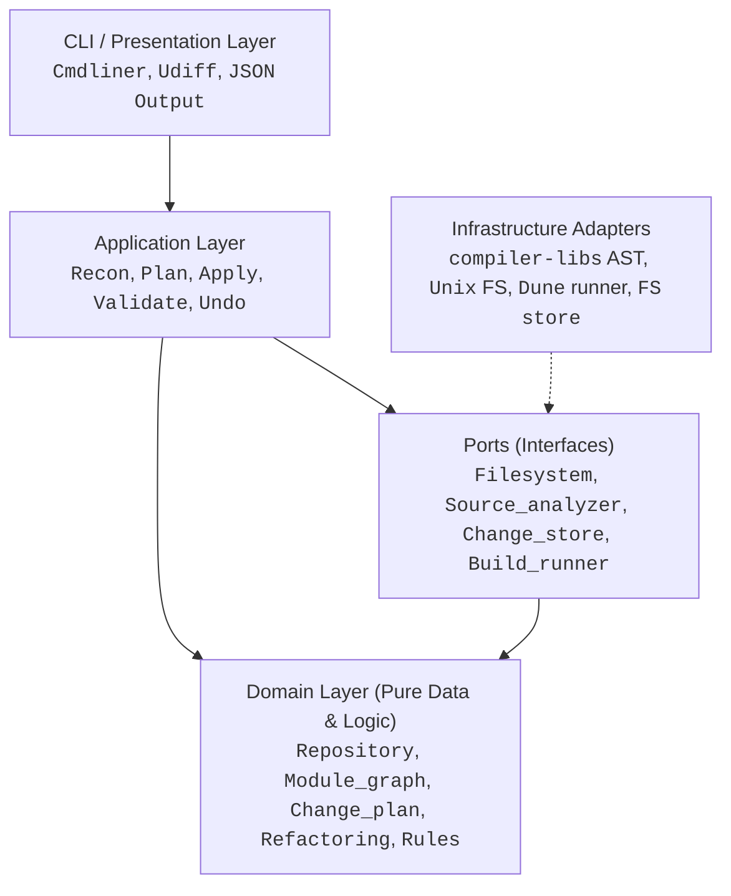

# reforge

[]()
[]()
[]()

> **Compiler-aware refactoring engine and architecture modeler for large OCaml repositories.**

`reforge` is not a collection of ad-hoc filesystem scripts or blind regex find-and-replace tools. It analyzes OCaml repositories, understands Dune build scopes and module namespaces, and performs safe, repeatable refactorings through explicit, validatable **Change Plans**.

Every mutating operation follows a strict transactional workflow:
```
reforge plan move  ──>  reforge preview  ──>  reforge apply  ──>  reforge validate
                                                                       │
                                                      (if needed) ◄────┘
                                                      reforge undo
```

---

## Key Features

- **Semantic Module & File Moves**:
  - Automatically updates module references across files (handling both intra-scope and cross-scope references, including wrapped library prefixes like `Sample_lib.Module`).
  - Auto-couples `.ml` and `.mli` files so interfaces never get left behind.
  - Automatically rewrites Dune `(modules ...)` explicit and difference lists.
- **Dependency Graph & Cycle Detection**:
  - Computes file- and module-level dependency graphs deterministically.
  - Detects dependency cycles using Tarjan's SCC algorithm with canonical sorting.
- **Safety Preconditions & Invariants**:
  - Validates pre-conditions (content hash digests, destination paths being free) before executing.
  - Rejects stale changes and conflicting edits cleanly without corrupting the working tree.
- **Full Atomic Undo & Backups**:
  - Preserves exact byte-level snapshots under `.reforge/backup/` for every touched file.
  - Allows one-command safe rollback via `reforge undo`.
- **Architectural Rules & Reporting**:
  - Flags unassigned source files (files not governed by any Dune stanza).
  - Detects `(modules ...)` drift against directory contents.
  - Warns on missing interface files (`.mli`) and unresolved external symbols.
- **CI-Ready & Hexagonal Design**:
  - Stable exit codes and optional `--json` output across all commands.
  - Strict Domain-Driven Design (DDD) + Ports and Adapters architecture.

---

## Architecture

`reforge` follows Domain-Driven Design (DDD) and Hexagonal Architecture (Ports and Adapters). Dependencies strictly point inward:



- **Domain (`lib/domain/`)**: Pure OCaml types and algorithms (no I/O, no filesystem). Contains repository models, change plans, AST location types, Tarjan SCC, and refactoring planning.
- **Ports (`lib/ports/`)**: Module signatures defining dependencies required by the application.
- **Infrastructure (`lib/infrastructure/`)**: Concrete adapters using OCaml's `compiler-libs` (AST traversal), POSIX filesystem operations, Dune runner, and `.reforge/` storage.
- **Application (`lib/application/`)**: Use cases orchestrating domain entities and ports.
- **CLI (`lib/cli/`, `bin/`)**: Command routing, arguments, diff rendering, formatting, and stable exit code handling.

---

## Installation & Build

### Prerequisites
- OCaml >= 5.2 (tested up through OCaml 5.4.1)
- Dune >= 3.13
- `cmdliner`, `yojson`, `compiler-libs`, `alcotest`

### Build from source
```bash
git clone https://github.com/your-org/reforge.git
cd reforge
eval $(opam env)
dune build @all
```

Run tests:
```bash
dune runtest
```

Install locally:
```bash
dune install
```

---

## CLI Reference

```
reforge [COMMAND] [OPTIONS]
```

### Common Flags
- `--root <DIR>`: Path to the repository root (defaults to current working directory).
- `--json`: Format all command output as structured JSON.
- `--help`: Display contextual help and options.

### Inspection & Analysis
| Command | Description |
|---|---|
| `reforge scan` | Inventory files, hashes, and Dune build scopes. |
| `reforge tree` | Display directories and their OCaml compilation units. |
| `reforge inspect <FILE>` | Deep inspection of an OCaml file: defined modules, references, and Dune scope forms. |
| `reforge deps [--dot]` | Show the module dependency graph (or output Graphviz DOT). |
| `reforge cycles` | Detect module dependency cycles with Tarjan SCC. |
| `reforge report` | Run architectural linter (cycles, unassigned sources, module drift, missing interfaces). |

### Refactoring Workflow
| Command | Description |
|---|---|
| `reforge plan move <SRC> <DST>` | Generate a change plan to move/rename a file or directory with semantic rewrites. |
| `reforge plan rename-fn <FILE> <OLD> <NEW>` | Plan renaming a top-level function across definition, `.mli` interface, and all call sites repo-wide. |
| `reforge plan move-fn <SRC> <DST> <FN>` | Plan moving a top-level function to another module with `.mli` sync and call site updates. |
| `reforge plan rename-arg <FILE> <FN> <OLD> <NEW>` | Plan renaming a function argument (positional, labeled `~x`, or optional `?x`) across definition, body usages, `.mli`, and call sites. |
| `reforge plan remove-arg <FILE> <FN> <ARG>` | Plan removing an unused argument from definition, `.mli` signature, and call sites (rejects if used in body). |
| `reforge preview [PLAN]` | Show byte-precise unified diffs and operations of a plan (defaults to latest). |
| `reforge diff [--plan=PLAN]` | Show unified diffs for a plan or applied changes. |
| `reforge apply [PLAN]` | Execute the plan transactionally with automatic backups. |
| `reforge validate` | Run AST parse checks and Dune build to ensure repository health. |
| `reforge undo [PLAN]` | Roll back an applied plan from `.reforge/backup/`. |
| `reforge status` | List recorded change plans and their current states (`pending`, `applied`, `undone`). |

---

## Example Walkthrough

### 1. Plan a Move
Move `lib/util.ml` to `lib/common.ml`. `reforge` will automatically detect that `lib/util.mli` exists and couple it into the move, as well as finding all references in calling modules and Dune files:

```bash
$ reforge plan move lib/util.ml lib/common.ml
created .reforge/plans/plan-0001.json
  move lib/util.ml -> lib/common.ml (1 file, 3 edited)
  operations:
    mkdir lib
    move  lib/util.ml -> lib/common.ml
    move  lib/util.mli -> lib/common.mli
    edit  bin/main.ml (1 edits)
    edit  lib/dune (1 edits)
    edit  lib/helper.ml (1 edits)
next: reforge preview .reforge/plans/plan-0001.json
```

### 2. Preview the Diffs
```bash
$ reforge preview
plan plan-0001: move lib/util.ml -> lib/common.ml (1 file, 3 edited)
command: reforge plan move lib/util.ml lib/common.ml

+++ b/bin/main.ml
--- a/bin/main.ml
@@ -1,4 +1 @@
 let () =
-  let x = Sample_lib.Util.version () in
+  let x = Sample_lib.Common.version () in
   let y = Sample_lib.Helper.describe 42 in
   print_endline (x ^ y)

+++ b/lib/dune
--- a/lib/dune
@@ -1,3 +1 @@
 (library
  (name sample_lib)
- (modules util helper))
+ (modules helper common))

+++ b/lib/helper.ml
--- a/lib/helper.ml
@@ -1,3 +1 @@
-open Util
+open Common
```

### 3. Apply the Plan
```bash
$ reforge apply
applied plan-0001
  2 moved, 3 edited, 0 written, 1 dirs created
next: reforge validate
```

### 4. Validate
```bash
$ reforge validate
[ ok ] parse-check (5 files)
[ ok ] build
```

### 5. Safe Rollback
If you ever want to revert:
```bash
$ reforge undo
restored lib/helper.ml
restored bin/main.ml
restored lib/dune
moved back lib/common.mli -> lib/util.mli
moved back lib/common.ml -> lib/util.ml
```

### 6. Function-Level Refactoring

Rename a top-level function across its definition, `.mli` val spec, and all call sites in the repository:
```bash
# Plan rename
$ reforge plan rename-fn lib/util.ml hello greet_msg
created .reforge/plans/plan-0002.json
  rename fn hello -> greet_msg in lib/util.ml (3 files edited)
  operations:
    edit  bin/main.ml (1 edits)
    edit  lib/util.ml (2 edits)
    edit  lib/util.mli (1 edits)

# Preview and apply
$ reforge preview
$ reforge apply
$ reforge validate
```

Move a function from one module to another:
```bash
# Plan function move
$ reforge plan move-fn lib/util.ml lib/extra.ml greet_msg
created .reforge/plans/plan-0003.json
  move fn greet_msg from lib/util.ml to lib/extra.ml (3 files edited)
  operations:
    edit  bin/main.ml (1 edits)
    edit  lib/extra.ml (1 edits)
    edit  lib/util.ml (1 edits)

$ reforge apply
$ reforge validate
```

### 7. Function Argument Refactoring

#### Rename a Function Argument
Rename a positional or labeled/optional argument. For positional arguments, definition and body usages are updated without breaking callers. For labeled arguments (`~x` or `?x`), the parameter definition, the arrow signature in `.mli`, and call sites across the codebase (`~old:v` -> `~new:v`, punned `~old` -> `~new:old`) are updated:

```bash
# Rename labeled argument ~fmt to ~format
$ reforge plan rename-arg lib/util.ml greet fmt format
created .reforge/plans/plan-0004.json
  rename arg 'fmt' -> 'format' in greet (lib/util.ml) (3 files edited)
  operations:
    edit  bin/main.ml (1 edits)
    edit  lib/util.ml (2 edits)
    edit  lib/util.mli (1 edits)

$ reforge preview
$ reforge apply
$ reforge validate
```

#### Remove an Unused Argument
Remove an obsolete argument from function definitions, interface signatures (`.mli`), and labeled call sites. Reforge enforces a safety invariant: if the argument is referenced in the function body, the plan is rejected with `Arg_in_use`:

```bash
# Remove unused argument `dummy`
$ reforge plan remove-arg lib/util.ml greet dummy
created .reforge/plans/plan-0005.json
  remove arg 'dummy' from greet (lib/util.ml) (2 files edited)
  operations:
    edit  lib/util.ml (1 edits)
    edit  lib/util.mli (1 edits)

$ reforge apply
$ reforge validate
```

---

## Exit Codes

`reforge` returns predictable exit codes for scripting and CI pipelines:

| Code | Meaning |
|---|---|
| `0` | Success |
| `1` | Usage error or unhandled runtime failure |
| `2` | Post-apply validation failed (`reforge validate`) |
| `3` | Plan rejected (stale input, precondition violation, conflicting target) |
| `4` | Architectural violations or dependency cycles detected (`reforge report`, `reforge cycles`) |
| `5` | Undo refused (working tree modified or backups missing) |

---

## License

MIT License. See [LICENSE](LICENSE) for details.
